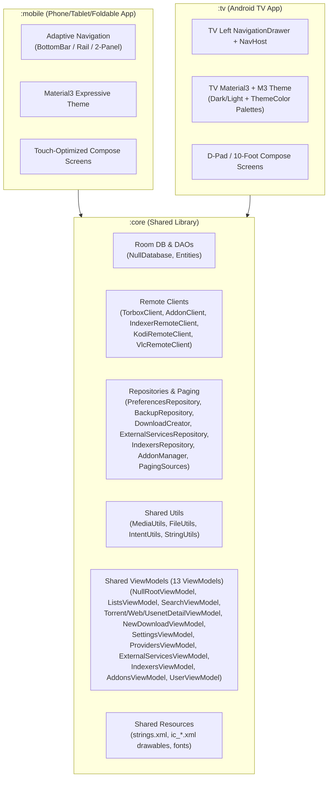

# Populate `:tv` Module & Share Code via `:core`

## Goal Description
Adapt all screens from `:mobile` to the `:tv` module with a 10-foot Android TV UI (D-pad navigation, left `NavigationDrawer`, focusable cards/lists using `androidx.tv.material3` combined with standard Compose `material3` for dialogs/inputs), while maximizing code reuse by moving shared models, remote clients, repositories, paging sources, utilities, ViewModels, DI bindings, and resources (`strings.xml`, vector drawables, fonts) into `:core`.

---

## Architecture & Code Reuse Overview

---

## Proposed Changes

### 1. Shared Module (`:core`)

#### [MODIFY] [build.gradle.kts](file:///home/user/Documents/GitHub/nullseek/core/build.gradle.kts)
- Add dependencies needed by shared repositories, paging sources, and ViewModels:
  - `implementation(libs.androidx.paging)`
  - `implementation(libs.kotlinx.datetime)`
  - `implementation(libs.androidx.lifecycle.runtime.ktx)`
  - `implementation(libs.androidx.compose.runtime)`
  - `implementation(libs.koin.compose.viewmodel)`

#### [MOVE] Data Layer from `:mobile` to `:core`
Move the following files from `mobile/src/main/java/...` to `core/src/main/java/...`:
- **Models**:
  - `data/model/ExternalService.kt`
  - `data/model/Indexer.kt`
  - `data/model/SearchResult.kt`
- **Remote Clients**:
  - `data/remote/IndexerRemoteClient.kt`
  - `data/remote/KodiRemoteClient.kt`
  - `data/remote/VlcRemoteClient.kt`
- **Repositories & Paging Sources**:
  - `data/repository/PreferencesRepository.kt`
  - `data/repository/DownloadCreator.kt`
  - `data/repository/ExternalServicesRepository.kt`
  - `data/repository/IndexersRepository.kt`
  - `data/repository/TorrentsPagingSource.kt`
  - `data/repository/UsenetPagingSource.kt`
  - `data/repository/WebPagingSource.kt`

#### [MOVE] Utils & Resources from `:mobile` to `:core`
- Move `utils/MediaUtils.kt`, `utils/FileUtils.kt`, and `utils/IntentUtils.kt` to `:core` (and delete duplicate `mobile/.../utils/StringUtils.kt` in favor of `:core`'s `StringUtils.kt`).
- Move `mobile/src/main/res/values/strings.xml`, `mobile/src/main/res/drawable/ic_*.xml` (and `logo.xml`), and `mobile/src/main/res/font/*` into `core/src/main/res/` so both `:mobile` and `:tv` share all localized strings, icons, and fonts without duplication.

#### [MOVE] Shared ViewModels & Navigation Routes to `:core`
Move all shared ViewModels and their state/event classes to `:core`:
- `NullRootViewModel.kt`
- `ui/lists/ListsViewModel.kt`
- `ui/lists/torrent/TorrentDetailViewModel.kt`
- `ui/lists/web/WebDownloadDetailViewModel.kt`
- `ui/lists/usenet/UsenetDetailViewModel.kt`
- `ui/search/SearchViewModel.kt`
- `ui/newdownload/NewDownloadViewModel.kt`
- `ui/user/UserViewModel.kt`
- `ui/settings/SettingsViewModel.kt`
- `ui/providers/ProvidersViewModel.kt`
- `ui/externalservices/ExternalServicesViewModel.kt`
- `ui/externalservices/IndexersViewModel.kt`
- `ui/addons/AddonsViewModel.kt`
- `ui/navigation/NavigationActions.kt` (`NullRoute` serializable destinations)

#### [MODIFY] [Module.kt](file:///home/user/Documents/GitHub/nullseek/core/src/main/java/com/github/livingwithhippos/nullseek/core/di/Module.kt)
- Register shared repositories (`PreferencesRepository`, `ExternalServicesRepository`, `IndexersRepository`, `DownloadCreator`, `AddonSearchHelper`), remote clients (`OkHttpClient`, `KodiRemoteClient`, `VlcRemoteClient`, `IndexerRemoteClient`), and all shared ViewModels in `appModule()` so both `:mobile` and `:tv` get the full DI graph from `appModule()`.

---

### 2. Mobile Module (`:mobile`) Cleanup

#### [MODIFY] [MobileModule.kt](file:///home/user/Documents/GitHub/nullseek/mobile/src/main/java/com/github/livingwithhippos/nullseek/di/MobileModule.kt)
- Remove duplicate repository and ViewModel bindings now provided by `:core`'s `appModule()`, keeping only mobile-only bindings (such as `NullViewModel`).

---

### 3. TV Module (`:tv`) Implementation

#### [MODIFY] [build.gradle.kts](file:///home/user/Documents/GitHub/nullseek/tv/build.gradle.kts)
- Add `kotlin("plugin.serialization")` plugin.
- Add dependencies matching `:mobile` for shared functionality plus TV Compose:
  - `implementation(libs.androidx.compose.material3.alpha)` (for dialogs, text fields, and shared M3 widgets)
  - `implementation(libs.androidx.paging)` & `implementation(libs.androidx.paging.compose)`
  - `implementation(libs.compose.navigation)`
  - `implementation(libs.kotlin.serialization.core)` & `implementation(libs.kotlin.serialization.json)`
  - `implementation(libs.kotlinx.datetime)`
  - `implementation(libs.square.logcat)`
  - `implementation(libs.torbox.client)`
  - `implementation(platform(libs.koin.bom))`, `implementation(libs.koin.android)`, `implementation(libs.koin.androidx.compose)`, `implementation(libs.koin.annotations)`
- Enable `buildConfig = true` in `buildFeatures`.

#### [MODIFY] [AndroidManifest.xml](file:///home/user/Documents/GitHub/nullseek/tv/src/main/AndroidManifest.xml)
- Add `INTERNET`, `ACCESS_NETWORK_STATE`, and `ACCESS_LOCAL_NETWORK` permissions.
- Set `android:name=".TvApplication"` and `android:usesCleartextTraffic="true"` on `<application>` (required for local Kodi/Vlc/Jackett/Prowlarr HTTP endpoints).

#### [NEW] [TvApplication.kt](file:///home/user/Documents/GitHub/nullseek/tv/src/main/java/com/github/livingwithhippos/nullseek/tv/TvApplication.kt)
- Initialize `AndroidLogcatLogger` and `startKoin` with `appModule(debug = BuildConfig.DEBUG)`.

#### [MODIFY] [MainActivity.kt](file:///home/user/Documents/GitHub/nullseek/tv/src/main/java/com/github/livingwithhippos/nullseek/tv/MainActivity.kt)
- Inject `NullRootViewModel`, observe `uiState`, `themeMode`, and `themeColor`, and render `TvNullSeekTheme` + `TvNullSeekApp`.

#### [MODIFY] TV Theme (`tv/src/main/java/com/github/livingwithhippos/nullseek/tv/ui/theme/`)
- **[Color.kt](file:///home/user/Documents/GitHub/nullseek/tv/src/main/java/com/github/livingwithhippos/nullseek/tv/ui/theme/Color.kt)** & **[Theme.kt](file:///home/user/Documents/GitHub/nullseek/tv/src/main/java/com/github/livingwithhippos/nullseek/tv/ui/theme/Theme.kt)**:
  - Support all `ThemeMode` (`SYSTEM`, `LIGHT`, `DARK`) and `ThemeColor` palettes (`SYSTEM`, `PURPLE`, `BLUE`, `TEAL`, `GREEN`, `ORANGE`, `RED`), applying both `androidx.tv.material3.MaterialTheme` and `androidx.compose.material3.MaterialTheme` so both TV Material3 focusable surfaces/cards and standard M3 inputs/dialogs share the same active color scheme.

#### [NEW] TV Navigation & Shell (`tv/src/main/java/com/github/livingwithhippos/nullseek/tv/ui/navigation/`)
- **`TvNullSeekApp.kt`**:
  - Left `ModalNavigationDrawer` / `NavigationDrawer` (`androidx.tv.material3.NavigationDrawer`) with D-pad focusable items for:
    - **Home** (`NullRoute.Home`)
    - **Lists** (`NullRoute.Lists`) — Torrents, Web Downloads, Usenet
    - **Search** (`NullRoute.Search`) — Indexers & Stremio Addons
    - **New Download** (`NullRoute.NewDownload`) — visible when logged in
    - **Settings** (`NullRoute.Settings`) — with nested routes for `Providers` and `ExternalServices`
  - Side-by-side detail panel on wide TV screens when a Torrent, Web Download, or Usenet item is selected in `Lists` (or full-screen detail view with Back handling).

#### [NEW] TV Screens (`tv/src/main/java/com/github/livingwithhippos/nullseek/tv/ui/...`)
All screens reuse the shared ViewModels from `:core` and adapt layouts for 10-foot viewing and D-pad focus:
1. **`TvProviderSetupScreen.kt`** (`ui/provider/`):
   - D-pad friendly API token setup card + "Restore backup" button and status feedback.
2. **`TvHomeScreen.kt`** (`ui/home/`):
   - User account overview cards (plan, status, downloaded/uploaded stats, expiration) + quick actions when logged in, or setup prompt when logged out.
3. **`TvListsScreen.kt`** & Detail Screens (`ui/lists/`):
   - Tabbed/filterable view for **Torrents**, **Web Downloads**, and **Usenet** with search/filter controls and D-pad focusable cards.
   - **Master-detail 2-column layout** on TV: selecting an item opens **`TvTorrentDetailScreen`**, **`TvWebDownloadDetailScreen`**, or **`TvUsenetDetailScreen`** in the right pane (with full-width toggle/back navigation), supporting:
     - Play on external media player (`PlayChoiceDialog` for Kodi/VLC), Open/Share/Copy download link, Refresh, Delete, Export Magnet/Torrent.
     - Files list with search filter (respecting `filterFilesFullPath`), media type filter chips (Video/Audio/Subtitles), 5-line file path display, and per-file download/stream actions.
4. **`TvSearchScreen.kt`** (`ui/search/`):
   - Switch between **Indexers** and **Stremio Addons** search modes.
   - Search input bar, recent search history chips, sort/filter chips, IMDb title/series season & episode picker for Stremio, and result cards with 1-click add to Torbox or magnet/link actions.
5. **`TvNewDownloadScreen.kt`** (`ui/newdownload/`):
   - Tabs for **Torrent** (Magnet/Hash or `.torrent` file picker), **Web Link**, and **Usenet** (NZB link or `.nzb` file picker).
6. **`TvSettingsScreen.kt`**, **`TvProvidersScreen.kt`**, **`TvExternalServicesScreen.kt`** (`ui/settings/`, `ui/providers/`, `ui/externalservices/`):
   - Two-column or wide-card TV layout for:
     - **Providers** management (add, rename, replace token, set active, delete).
     - **External Services** (with first-time disclaimer dialog): **Media Players** (Kodi/VLC), **Indexers** (Jackett/Prowlarr), and **Stremio Addons** management.
     - **Theme & Appearance** (`ThemeMode` & `ThemeColor` selectors).
     - **Download Zip Mode**, **Auto-add download from search**, **Filter files by full path**, **Paging load size**, and **Backup & Restore**.

---

## Verification Plan
- Verify all imports and resource references across `:core`, `:mobile`, and `:tv`.
- Ensure `:mobile` continues to work with zero regressions after moving shared classes to `:core`.
- Ensure `:tv` has complete Koin DI wiring, manifest permissions, and D-pad navigable screens for all features.
